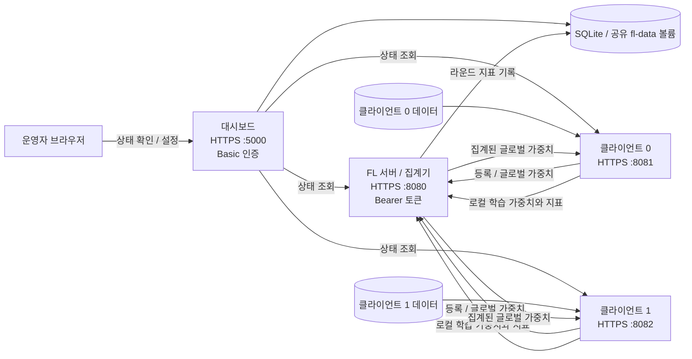
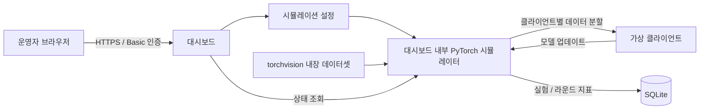

# FL Platform

Federated Learning 실험용 분산 서버·클라이언트와 학습 기록 대시보드를 제공합니다.

---

## 빠른 시작

### 방법 1 — Docker (권장)

먼저 인증정보와 개발용 TLS 인증서를 준비합니다.

```powershell
Copy-Item .env.example .env
# .env에서 FL_API_TOKEN과 FL_DASHBOARD_PASSWORD를 각각 임의의 긴 값으로 변경
python scripts/generate_dev_cert.py
```

생성 인증서는 로컬 개발 전용 자체 서명 인증서입니다. 브라우저에서 대시보드에 접속할 때 개발 인증서를 신뢰하도록 등록하거나 경고를 확인해야 합니다. 실제 서비스에서는 신뢰된 CA가 발급한 인증서를 사용하세요.

```powershell
docker compose up --build -d
```

첫 빌드가 끝난 뒤 다시 실행할 때는 `docker compose up -d`를 사용합니다. 실행 상태는 `docker compose ps`로, 종료는 `docker compose down`으로 확인합니다.

| 주소 | 설명 |
|------|------|
| https://localhost:5000 | 실험 기록 대시보드 (Basic 인증) |
| https://localhost:5000/deployment | Deployment Monitor (서버·클라이언트 상태) |
| https://localhost:8080 | FL 서버 API (Bearer 토큰) |
| https://localhost:8081 | 클라이언트 0 API (Bearer 토큰) |
| https://localhost:8082 | 클라이언트 1 API (Bearer 토큰) |

Compose 기본 구성은 서버 1개, 클라이언트 2개, 대시보드 1개를 실행합니다. 클라이언트는 서버가 준비되면 자동으로 학습을 시작합니다. 추가 노드는 별도 `python run.py client` 프로세스로 실행할 수 있습니다.

대시보드 로그인 계정은 `.env`의 `FL_DASHBOARD_USER`와 `FL_DASHBOARD_PASSWORD`입니다. 기본 예시 값은 로컬 확인용이며, 공유하거나 외부에 노출되는 환경에서는 두 값을 본인만 아는 값으로 바꾸세요.

### 빠른 첫 실습

기본 CIFAR-10 설정은 클라이언트당 25,000개 학습 샘플을 사용하고 기본 로컬 epoch가 5라 첫 라운드가 오래 걸릴 수 있습니다. 빠른 확인을 위해 `.env`를 다음처럼 바꿉니다.

```env
FL_DATASET=mnist
FL_ROUNDS=2
FL_LOCAL_EPOCH=1
FL_BATCH=32
FL_MIN_CLIENTS=2
FL_CLIENTS_PER_ROUND=2
```

저장한 뒤 컨테이너 설정을 적용합니다.

```powershell
docker compose up -d --force-recreate
```

대시보드의 **Deployment Monitor**에서 서버와 클라이언트 상태를 확인하고, 홈 화면 아래쪽 **Recent rounds** 표에서 라운드별 client 수, loss, accuracy를 확인합니다. 표는 페이지를 열 때 읽어 오므로 새 라운드가 끝난 뒤 브라우저에서 새로고침하세요. 첫 라운드 집계가 끝나기 전에는 표가 비어 있고, 로컬 시뮬레이션은 폼 옆 진행 상태가 `completed`가 되어야 결과가 기록됩니다. 학습 로그는 다음 명령으로 볼 수 있습니다.

```powershell
docker compose logs -f fl-server fl-client-0 fl-client-1
```

`Ctrl+C`는 로그 표시만 종료합니다. 컨테이너 종료는 `docker compose down`으로 합니다.

### 대시보드 로컬 시뮬레이션

홈 화면의 **Run local simulation**은 Docker 서버·클라이언트 학습과 별도로 대시보드 프로세스 안에서 실행하는 단일 머신 시뮬레이션입니다. 첫 시도는 `mnist`, rounds `1`, clients `2`, local epochs `1`로 시작하면 빠르게 확인할 수 있습니다. 양식 옆 상태가 `completed`가 된 뒤 페이지를 새로고침하면 실험과 **Recent rounds** 표에 결과가 표시됩니다. CIFAR-10이나 여러 epoch는 CPU에서 오래 걸릴 수 있습니다.

분산 Compose 학습과 로컬 시뮬레이션은 서로 다른 실행 경로입니다. 두 흐름의 상태와 결과를 혼동하지 않도록 실습 중 한 번에 하나씩 실행하는 것을 권장합니다.

### 실행 화면과 결과 읽기

아래는 실습 중 캡처한 두 화면을 각각 설명합니다.

#### 이미지 1 — 첫 라운드 집계 전

- 상단 **Experiments**가 `1`이고 **Tracked experiments**에는 `fl_deploy`만 있습니다. Docker 기반 분산 학습 작업 하나가 등록된 상태입니다.
- **Latest round**가 `—`이고 **Recent rounds**에 “Round metrics will appear after clients submit updates.”가 표시됩니다. 아직 클라이언트 업데이트가 서버에서 집계되지 않아 라운드 결과가 기록되지 않았다는 뜻입니다.
- **Run local simulation** 옆의 `running: round 0/3 Dataset ready`는 로컬 시뮬레이션 데이터 준비는 끝났지만 첫 라운드가 아직 완료되지 않았다는 의미입니다. 이 상태에서는 로컬 시뮬레이션 결과도 표에 나타나지 않습니다.
- **Open deployment monitor**를 누르면 Docker 서버와 클라이언트의 연결 상태를 별도로 확인할 수 있습니다.

따라서 이미지 1은 두 학습 흐름이 시작됐지만 결과 라운드가 아직 기록되기 전인 화면입니다. CIFAR-10은 CPU에서 오래 걸릴 수 있으므로 `round 0`에서 학습이 진행되는 동안 기다려야 합니다.

#### 이미지 2 — Docker 첫 라운드 집계 후

- **Experiments**가 `2`로 늘었고 **Tracked experiments**에 `simulation-e922a87a11`과 `fl_deploy`가 있습니다. 각각 대시보드 로컬 시뮬레이션과 Docker 분산 학습입니다.
- **Latest round**의 `1`은 집계가 완료된 최신 라운드가 1이라는 뜻입니다.
- **Recent rounds**의 `fl_deploy / Round 1 / Clients 2`는 Docker 클라이언트 두 개의 업데이트를 FL 서버가 집계했다는 뜻입니다. `Loss 1.420375...`는 손실 값이고 `Accuracy 0.48646`은 약 48.6% 정확도입니다.
- 이 화면에서도 로컬 시뮬레이션 상태는 `running: round 0/3`입니다. 아래 표의 1라운드 결과는 `simulation-...` 작업이 아니라 **fl_deploy의 Docker 라운드 결과**입니다.

대시보드의 진행 상태는 주기적으로 바뀌지만, **Tracked experiments**와 **Recent rounds** 표는 페이지를 새로고침해야 최신 기록으로 갱신됩니다. 다음 Docker 라운드나 로컬 시뮬레이션 라운드가 끝난 뒤 새로고침해 결과를 확인하세요.

---

## 시스템 구조

### Docker 분산 학습



Compose는 `fl-data` named volume을 각 서비스의 `/data`에 연결합니다. 업로드 데이터는 애플리케이션 프로토콜로 서버에 전송하지 않지만, Compose 구성에서는 같은 볼륨을 마운트한 컨테이너가 파일 경로에 접근할 수 있습니다. 컨테이너 간 데이터 접근까지 격리해야 하는 환경에서는 클라이언트별 볼륨 구성이 추가로 필요합니다.

### 로컬 시뮬레이션



로컬 시뮬레이션은 Docker 분산 서버와 클라이언트 API를 거치지 않습니다. 결과는 대시보드가 사용하는 SQLite에 기록됩니다.

---

### 방법 2 — 로컬 직접 실행

```bash
pip install -r requirements.txt
python scripts/generate_dev_cert.py
```

로컬 실행도 TLS 인증서, `FL_API_TOKEN`, `FL_DASHBOARD_USER`, `FL_DASHBOARD_PASSWORD` 환경변수가 필요합니다. 현재 셸에 값을 설정하고 서비스를 실행하세요.

환경변수는 `.env`를 자동으로 읽는 Compose와 달리 Python 직접 실행에서는 현재 셸에 설정해야 합니다. PowerShell 예시:

```powershell
$env:FL_API_TOKEN = "a-long-random-secret-value-at-least-32-chars"
$env:FL_DASHBOARD_USER = "admin"
$env:FL_DASHBOARD_PASSWORD = "a-different-long-random-password"
$env:FL_TLS_CERT = "certs/server.crt"
$env:FL_TLS_KEY = "certs/server.key"
$env:FL_TLS_CA = "certs/server.crt"
```

**터미널 1 — 대시보드**
```bash
python run.py
# https://localhost:5000
```

**터미널 1~4 — 분산 배포**
```bash
# 터미널 1: FL 서버
python run.py server --port 8080 --min-clients 2 --rounds 10

# 터미널 2: 클라이언트 0
python run.py client --server https://localhost:8080 --client-id client_0 --port 8081

# 터미널 3: 클라이언트 1
python run.py client --server https://localhost:8080 --client-id client_1 --port 8082

# 터미널 4: 대시보드 (Deployment 탭 포함)
python run.py dashboard \
  --fl-server-url https://localhost:8080 \
  --fl-client-urls https://localhost:8081,https://localhost:8082
```

---

## run.py 옵션

### `python run.py dashboard`
| 옵션 | 기본값 | 설명 |
|------|--------|------|
| `--port` | 5000 | 웹 서버 포트 |
| `--db` | ./tracking.db | SQLite DB 경로 |
| `--fl-server-url` | (없음) | FL 서버 URL (Deployment 탭용) |
| `--fl-client-urls` | (없음) | 클라이언트 URL 콤마 구분 |

### `python run.py server`
| 옵션 | 기본값 | 설명 |
|------|--------|------|
| `--port` | 8080 | 서버 포트 |
| `--model` | simple_cnn | 모델 이름 |
| `--dataset` | cifar10 | 데이터셋 |
| `--rounds` | 20 | 총 FL 라운드 수 |
| `--min-clients` | 2 | 학습 시작에 필요한 최소 클라이언트 수 |
| `--clients-per-round` | 5 | 라운드당 집계할 클라이언트 수 |
| `--strategy` | fedavg | 집계 전략 |

### `python run.py client`
| 옵션 | 기본값 | 설명 |
|------|--------|------|
| `--server` | https://localhost:8080 | FL 서버 주소 |
| `--client-id` | client_0 | 고유 클라이언트 ID |
| `--port` | 8081 | 이 노드의 Flask 포트 |
| `--model` | simple_cnn | 모델 이름 |
| `--dataset` | cifar10 | 데이터셋 |
| `--partition-id` | 0 | 데이터 파티션 인덱스 |
| `--num-clients-total` | 5 | 전체 클라이언트 수 (데이터 분할용) |
| `--split-type` | iid | iid / dirichlet / class_based |
| `--alpha` | 0.5 | Dirichlet 분할 농도 파라미터 |
| `--data-dir` | ./data | 내장 데이터셋 저장 경로 |
| `--local-epoch` | 5 | 로컬 학습 에폭 수 |
| `--lr` | 0.01 | 학습률 |
| `--batch-size` | 32 | 배치 크기 |
| `--optimizer` | sgd | sgd / adam |
| `--no-auto-start` | (없음) | 학습 루프 자동 시작 안 함 |

---

## 데이터셋 업로드

### 지원 포맷

| 포맷 | 구조 |
|------|------|
| ZIP (ImageFolder) | `train/class명/이미지.*` + 선택적 `test/` |
| ZIP (flat) | `class명/이미지.*` (자동 80/20 분할) |
| NPZ | 키: `x_train, y_train, x_test, y_test` |
| CSV | 첫 번째 열 = 레이블, 나머지 = 픽셀값 |

### 업로드 방법

클라이언트의 `POST /upload-dataset`에 ZIP, NPZ, CSV 파일을 multipart `file` 필드로 보냅니다. 업로드 후 해당 클라이언트의 다음 학습 라운드부터 업로드 데이터가 사용됩니다. 모든 참가 클라이언트에 각자의 데이터를 업로드해야 합니다.

지원 형식:

- ZIP: 이미지 클래스별 하위 폴더가 있는 ImageFolder 형식. `train/` 루트가 있으면 그 안을 사용합니다.
- NPZ: `x_train`, `y_train` 배열. 이미지는 NHWC 또는 NCHW 형식이며 1채널/3채널을 지원합니다.
- CSV: 첫 열은 정수 라벨, 나머지는 28×28 grayscale 또는 32×32 RGB 이미지 픽셀 값입니다. 헤더 행은 선택 사항입니다.

`dataset` 설정에 따라 모델 입력 채널이 결정됩니다. MNIST/FashionMNIST는 1채널, 그 외 데이터셋은 3채널을 기대합니다.

각 클라이언트에 인증된 업로드 요청을 보내 해당 노드의 로컬 데이터로 설정합니다. 업로드 데이터 자체는 학습 서버로 전송되지 않습니다.

### 로컬 시뮬레이션

대시보드 홈 화면의 **Run local simulation** 양식에서 데이터셋, 모델, 라운드 수, 클라이언트 수, 분할 및 집계 방식을 지정해 실행할 수 있습니다. 시뮬레이션은 백그라운드 스레드에서 동작하고 SQLite에 라운드 지표를 기록합니다. 진행 표시는 `running: round 현재/전체` 형식입니다. `round 0`은 첫 라운드 학습이 아직 끝나지 않은 상태이며, 라운드 결과는 집계가 끝난 뒤 **Recent rounds**에 나타납니다. CIFAR-10은 CPU에서 오래 걸릴 수 있습니다. 결과 표가 갱신되지 않으면 시뮬레이션이 `completed`가 된 뒤 브라우저를 새로고침하세요.

---

## 집계 전략

| 전략 | 설명 | 특징 |
|------|------|------|
| FedAvg | 가중 평균 | 표준 |
| FedProx | 근사항 추가 | Non-IID 강인 |
| FedAdam | 서버 Adam | 적응형 |
| FedYogi | 서버 Yogi | 적응형 |
| FedAvgM | 서버 모멘텀 | 표준 |
| FedMedian | 좌표별 중앙값 | 강건성 |
| Krum | Byzantine 강건 선택 | 강건성 |
| DP-FedAvg | 데모용 clipping/noise 옵션 | 형식적 차등 프라이버시 보장 없음 |

---

## 현재 런타임의 모델

기본 구현은 `simple_cnn`, `lenet`, `mlp`, `logistic`과 torchvision `resnet18/34/50/101`을 지원합니다. `fedavg_cnn`, `fedbn_cnn`, `floco_net`, `rnn`, `gru`는 기본 CNN/MLP 구조의 별칭이며 논문 아키텍처를 그대로 구현한 모델이 아닙니다.

---

## REST API

`/health`를 제외한 서버·클라이언트 API는 다음 헤더로 인증합니다. 서비스 간 전송은 HTTPS이며 인증서 검증을 수행합니다.

```http
Authorization: Bearer <FL_API_TOKEN>
```

Compose는 `.env`의 토큰과 대시보드 계정을 필수로 요구합니다. 대시보드는 HTTP Basic 인증을 사용하므로 브라우저 인증 창에 `.env`의 `FL_DASHBOARD_USER`와 `FL_DASHBOARD_PASSWORD`를 입력합니다. 서버·클라이언트 API는 Bearer 토큰을 사용합니다. 대시보드의 실험·라운드 표는 새 라운드가 끝난 뒤 브라우저를 새로고침해야 갱신됩니다.

### FL 서버 (`https://localhost:8080`)

| 메서드 | 경로 | 설명 |
|--------|------|------|
| GET | `/status` | 서버 상태, 라운드 정보 |
| POST | `/register` | 클라이언트 등록 |
| GET | `/global-model` | 글로벌 모델 가중치 다운로드 |
| POST | `/upload-weights` | 클라이언트 가중치 업로드 |
| POST | `/predict` | 글로벌 모델로 예측 |
| GET | `/admin/clients` | 등록된 클라이언트 목록 |
| POST | `/admin/next-round` | 다음 라운드 강제 진행 |
| POST | `/admin/reset` | 서버 상태 초기화 |

### FL 클라이언트 (`https://localhost:8081`)

| 메서드 | 경로 | 설명 |
|--------|------|------|
| GET | `/status` | 클라이언트 상태, 학습 지표 |
| POST | `/train` | 수동으로 학습 1라운드 실행 |
| POST | `/predict` | 로컬 모델로 예측 |
| POST | `/upload-dataset` | 데이터셋 수신 (ZIP/NPZ/CSV) |
| POST | `/admin/start` | 자동 학습 루프 시작 |
| POST | `/admin/stop` | 자동 학습 루프 정지 |

### 예측 요청 예시

**이미지 파일:**
```bash
curl --cacert certs/server.crt -H "Authorization: Bearer $FL_API_TOKEN" \
  -X POST https://localhost:8080/predict?top_k=5 \
  -F "image=@test.jpg"
```

**JSON 배열:**
```bash
curl --cacert certs/server.crt -H "Authorization: Bearer $FL_API_TOKEN" \
  -X POST https://localhost:8080/predict \
  -H "Content-Type: application/json" \
  -d '{"input": [[[0.1, 0.2, ...], ...]]}'
```

---

## 파일 구조

```
fl-platform/
├── run.py, server.py, client.py   # 대시보드/서버/클라이언트 진입점
├── config.yaml                    # 기본 실험 설정 참고 파일
├── docker-compose.yml             # 서버 + 클라이언트 2대 + 대시보드
├── skills/skill.py                # 저장소 작업 명령
└── fl_platform/
    ├── config.py                  # YAML 설정 읽기 함수
    ├── tracking.py                # SQLite 실험·라운드·클라이언트 기록
    ├── models/model_registry.py   # PyTorch 모델 팩토리
    ├── deploy/                    # HTTP 서버, 클라이언트, 가중치 프로토콜
    └── dashboard/app.py           # 학습 기록 및 노드 상태 대시보드
```

---

## Docker 환경변수

Docker 이미지는 `python:3.11-slim`과 CPU 전용 PyTorch/torchvision 휠을 사용합니다. Compose에는 GPU 설정이 없으므로 기본 학습은 CPU에서 진행됩니다. Flower와 Optuna는 현재 서비스 코드에서 사용하지 않아 Docker 런타임 의존성에서는 제외했습니다.

`docker-compose.yml`에서 `.env` 파일로 설정 변경 가능:

```env
FL_MODEL=resnet18
FL_DATASET=cifar10
FL_ROUNDS=20
FL_MIN_CLIENTS=2
FL_CLIENTS_PER_ROUND=2
FL_NUM_CLIENTS=2
FL_SPLIT=iid
FL_LOCAL_EPOCH=5
FL_LR=0.01
FL_BATCH=32
FL_STRATEGY=fedavg
```

예시:
```bash
FL_MODEL=resnet18 FL_ROUNDS=30 docker compose up --build
```
